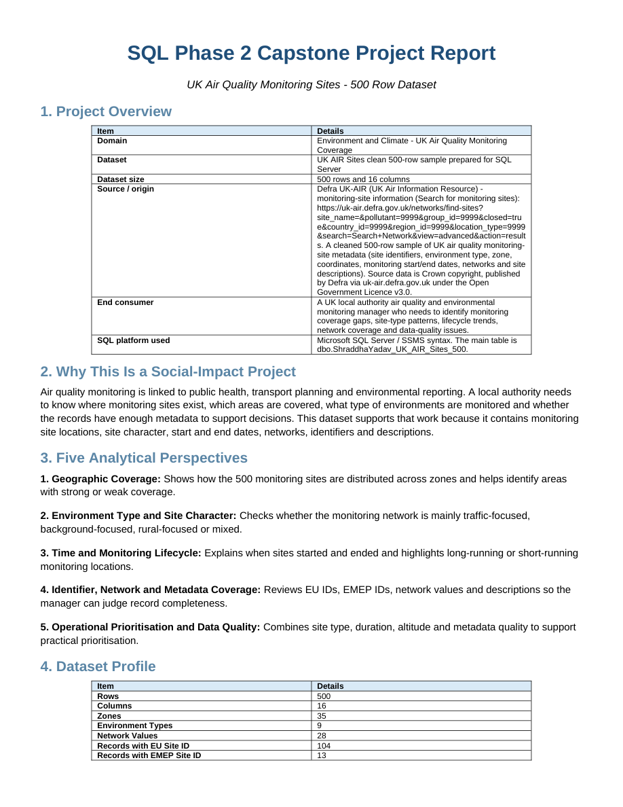

# UK Air Quality Monitoring Sites — SQL Capstone

**Portfolio: Shraddha Yadav · SQL Phase 2**

A SQL Server capstone analysing the coverage, characteristics, lifecycle and metadata quality of **500 UK air-quality monitoring sites**. The supplied report explicitly identifies this as a “SQL Phase 2 Capstone Project Report”. It uses monitoring-site metadata, not pollutant-concentration readings.

## Tools and data

Microsoft SQL Server / T-SQL; SQL Server Management Studio; CSV; 34-page PDF report.

## Key findings

- The supplied sample covers **35 zones** and **nine environment types**, with all 500 records containing latitude and longitude.
- **104 records** have an EU site ID and **13** have an EMEP site ID. The CSV represents missing identifiers with the literal `Not Available`; these values must not be counted as genuine identifiers.
- **41 records** have a site description; the other 459 use `Not Available`. Metadata completeness is a central practical theme of the analysis.
- The original report organises 75 queries into geographic coverage, environment/site character, lifecycle, metadata and identifiers, and operational priorities.

## Project files

| File | Contents |
|---|---|
| [ShraddhaYadav_SQLPhase2_Project.sql](./ShraddhaYadav_SQLPhase2_Project.sql) | Original combined SQL script, preserved byte-for-byte |
| [DATA_500.csv](./DATA_500.csv) | Supplied cleaned dataset, preserved byte-for-byte |
| [ShraddhaYadav_SQLPhase2_Report.pdf](./ShraddhaYadav_SQLPhase2_Report.pdf) | 34-page project report, preserved byte-for-byte |
| [DATA_DICTIONARY.csv](./DATA_DICTIONARY.csv) | Original data dictionary |
| [QUERY_INDEX_75.csv](./QUERY_INDEX_75.csv) | Original 75-query index |
| [Project_Files.zip](./Project_Files.zip) | Complete original internal file tree |

## Open and run

1. Download [the combined SQL script](./ShraddhaYadav_SQLPhase2_Project.sql) or extract [Project_Files.zip](./Project_Files.zip).
2. Open the script in **SQL Server Management Studio** or another SQL Server client that handles `GO` batches.
3. Select a separate project database and execute the setup/build sections. The self-contained script creates `dbo.ShraddhaYadav_UK_AIR_Sites_500`, inserts all 500 records, creates indexes/views and includes Q01–Q75.
4. Run the numbered analysis queries and compare with [the supplied report](./ShraddhaYadav_SQLPhase2_Report.pdf). Use [DATA_DICTIONARY.csv](./DATA_DICTIONARY.csv) and [QUERY_INDEX_75.csv](./QUERY_INDEX_75.csv) for navigation.

The setup drops and recreates its named table and four views. Use a dedicated database. This script is T-SQL for SQL Server; it is not a SQLite script.

## Verification and limitations

The source ZIP passed its CRC integrity check. All visible source files and original archived members were verified byte-for-byte. The supplied dataset was checked for 500 rows and 16 columns, and the metadata counts above were checked directly from the CSV. No SQL Server runtime execution is claimed.

SQL Server execution was not available during preparation, so the T-SQL build and its 75 analysis queries were not rerun. The source report contains its original results. `QUERY_INDEX_75.csv` refers to Q01.sql–Q75.sql, but individual query files were not included: those numbered queries are present in the combined SQL script. Site dates and metadata describe the supplied extract; they are not verified current operational statuses. The supplied report attributes the dataset to Defra UK-AIR monitoring-site metadata and the Open Government Licence v3; that source attribution is retained in the original files.

## Report preview

The image below is a genuine render of the supplied report's first page; it is a report preview, not a dashboard screenshot.

[Back to the portfolio](https://github.com/yadavshraddha325-lang/shraddha-yadav-data-analytics-portfolio)
